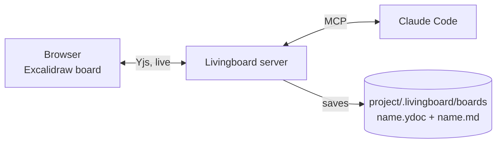

<div align="center">

<h1>✳&#xFE0E; Livingboard</h1>

<p><b>The whiteboard Claude reads.</b><br>
Draw your project. Claude reads the board, answers on it, draws back,<br>and keeps board and code in sync, both ways.</p>

<p>
<a href="https://www.npmjs.com/package/livingboard"></a>
<a href="https://github.com/moneyghost/livingboard/blob/main/LICENSE"></a>


</p>

<p>
<a href="#quick-start">Quick start</a> ·
<a href="#what-it-does">What it does</a> ·
<a href="#why-a-board">Why a board</a> ·
<a href="#how-it-works">How it works</a> ·
<a href="#reference">Reference</a>
</p>


<sub>A real board, recorded. Claude's side is scripted for the recording, through the same MCP tools Claude Code uses.</sub>

</div>

<br>

With a text prompt you give an instruction, get a result, and an hour later the big picture is lost in the scroll. **In Livingboard the prompt is the board.** You sketch screens, flows and ideas; Claude reads them, builds, and puts back on the board what it did: screens, tables, diagrams, screenshots. People and Claude both edit it over time, and the board always matches the project. Change a cell in Claude's table and Claude changes the code; Claude changes the code and redraws the drawing.

## Quick start

Needs Node.js 22+ and [Claude Code](https://claude.com/claude-code). Once:

```bash
npm install -g livingboard
livingboard install
```

Then, in any project, in a new Claude Code session:

```
/whiteboard
```

The board opens in your browser and Claude starts working on it. There is nothing to run by hand: the server starts on the first call and serves every project. Boards are saved **inside the project** (`.livingboard/boards/`), so they are versioned with the code.

On an empty board, **Load the example: weather app** shows a finished one.

## What it does

<table>
<tr>
<td width="50%" valign="top">

<h3>Sketch it, ask on the board</h3>
Claude reads sketches, handwriting and arrows as you draw. Write <code>@claude …</code> anywhere and the answer appears right next to it.
</td>
<td width="50%" valign="top">

<h3>Claude draws back</h3>
Real screens, illustrations, tables and charts, in the board's hand-drawn style. Everything Claude draws is made of normal elements you can move and edit.
</td>
</tr>
<tr>
<td width="50%" valign="top">

<h3>Maps of the whole thing</h3>
Concept maps, flows and architectures from Mermaid, so the shape of the project is visible at a glance and stays current.
</td>
<td width="50%" valign="top">

<h3>Point at anything</h3>
Draw an arrow from any drawing and say what you want. Claude does it and redraws the same drawing in place, without piling up copies.
</td>
</tr>
<tr>
<td width="50%" valign="top">

<h3>Your edits are instructions</h3>
Rewrite a cell in Claude's table, delete a row, fix a label: Claude receives the change and updates the project to match.
</td>
<td width="50%" valign="top">
<h3>Lives in your repo</h3>
Next to every board Livingboard writes a readable copy that shows up in diffs and pull requests, and that any agent can read:

```markdown
## Claude's drawings

- **Go / no-go rules** (table): Rain · < 0.5 mm/h
  · Wind · < 20 km/h · Temp · > 4 °C
- **How Bike today? works** (diagram):
  Open-Meteo · Go / no-go rules · …
```

</td>
</tr>
</table>

**Also:**

- **iPad, GoodNotes style**: the Pencil draws, fingers pan and zoom, two-finger tap undoes. Add it to the Home Screen and it opens like an app.
- **Private by default**: the server listens only on your computer. With `--lan`, a tablet pairs once by scanning a QR code.
- **Any MCP client**: built for Claude Code, but the board talks plain MCP.
- **No domain built in**: nothing about apps, games or documents. The agent brings the domain; the board offers generic tools to read, draw and show images.

## Why a board?

| | Text prompt | Livingboard |
|---|---|---|
| **Big picture** | scattered across a long chat | one board you read at a glance |
| **Screens, flows, layouts** | described in words | drawn, where position is the content |
| **After a week** | scroll back and hope | the board shows the current state |
| **Changing a decision** | write a new message | edit the drawing; Claude updates the code |
| **Working together** | one person at the keyboard | everyone on the same board, live |

For bugs, refactoring and precise rules, text is still faster. Livingboard doesn't replace the chat; it gives it a map.

## How it works



Three layers, from strokes to meaning:

1. **Geometry**: raw Excalidraw elements, synced in real time with Yjs (CRDT).
2. **Candidates**: a fast geometric pass groups what probably expresses one idea: shape + text, nearby strokes, labels, arrows between groups. No interpretation, just cheap structure to read, with IDs that stay stable while you draw.
3. **Meaning**: Claude gives each candidate a free type (screen, rule, mob…), properties and relations. The types form an ontology that emerges from the board; nobody defines it upfront.

An idea reaches Claude only when nobody has touched it for a few seconds, so text is never read half-written. Between messages, a hook tells Claude in one line if the board changed.

## Reference

<details>
<summary><b>What <code>livingboard install</code> sets up</b></summary>

<br>

Everything at user scope; `livingboard uninstall` removes it.

- The `livingboard` MCP server: a stdio bridge that Claude Code starts in the project folder (the folder decides the project). In projects where you don't use the board it costs about 300 tokens per session (two lines of instructions and the tool names); the full rules arrive only with `open_board`.
- The `/whiteboard` skill in `~/.claude/skills/whiteboard/`. `/whiteboard ui` opens another board of the same project.
- A `UserPromptSubmit` hook in `~/.claude/settings.json`: on every message, if the project's board changed since the last one, Claude knows (one line of context, no wait if the server is off).

The project registry, the LAN access token and the server log live in `~/.livingboard/` (`LIVINGBOARD_DATA` moves them). http://localhost:3333 lists every project and its boards. `livingboard start [--lan]` runs the server in the foreground, to use boards without Claude Code. If another program already uses port 3333, the server takes the next free one and Claude Code finds it by itself (`LIVINGBOARD_PORT` pins a port). After `npm update -g livingboard`, run `livingboard install` again only if the package moved (a different Node.js install).

</details>

<details>
<summary><b>iPad and tablets</b></summary>

<br>

`livingboard install --lan` makes the server reachable on your network. Each device pairs once: on the computer open a board, then **✳ Claude → Settings → Other devices**, and scan the QR code with the tablet. Devices without the code see nothing; *Unpair all devices* revokes them all.

Tablet mode turns on by itself on iPad (or from the panel's Settings, or with `?tablet=1`):

- **Apple Pencil draws, fingers navigate**: one finger pans, two fingers zoom, a resting palm is ignored.
- **Two-finger tap = undo, three-finger tap = redo**; the ↶ ↷ buttons are at the top anyway.
- **Big toolbar** with pen, highlighter, eraser, selection, text and shapes; colours and widths per tool, remembered on the device.
- **Finger: pan / draw** switch for people without a pen.

On desktop the Excalidraw tools stay, with clear *Undo* / *Redo* buttons at the bottom.

</details>

<details>
<summary><b>A clean board</b></summary>

<br>

- **Just drawings**: no labels over the board by default. Select something to see how Claude read it (type and name, with a card to correct it); the **AI lens** in the panel shows labels, relations and status on every idea.
- **Claude's messages show up right away**: answers and questions open next to what they are about, until you press *Ok* or reply right there; then they fold into a small ✳ (or an orange **?** if Claude is waiting for you). Messages about the whole board, off screen, or when zoomed far out sit in an inbox at the top with *Go there*. "Read" is per device.
- **No overlaps**: messages and labels avoid arrows, drawings, other ideas and what they talk about; views open only on request, or stay open for everyone when pinned 📌.
- **Tidy the board**: from the main menu (or proposed by Claude) a tree layout that follows your arrows, with a preview; nothing moves until you press *Apply*.
- **When grouping gets it wrong**: select the strokes and tap **⧉ One idea** (or **↺ Automatic** to go back). Claude can split and merge ideas too, by looking at the image.

</details>

<details>
<summary><b>How Claude draws and keeps it up to date</b></summary>

<br>

Claude draws in the board's style (ink colour, writing size), never over people's strokes:

- `draw_svg` is the main tool: Claude writes SVG and it becomes hand-drawn, editable Excalidraw elements (shapes, paths with arcs, fills, text, arrows, groups). Screens, objects, maps, timelines, illustrated explanations.
- `draw_table` for comparisons, lists with attributes, plans and statuses, with highlighted cells.
- `draw_diagram` (Mermaid), `draw_chart` (bars), `extend` (continues your tree along your arrows), `annotate` (circle, underline, tick), `note` (side note), `add_image` (a screenshot of what it built).

Every drawing has a `drawingId`. When the project changes Claude **redraws it in place** (`replace`) or **erases it** (`erase`), so the board shows the current state, not the history. When a person edits one of Claude's drawings, Claude receives the changed texts and updates the project. At most 20 words per element; long texts go in the **Document** tab of the panel. Claude writes on the board in the language people use there.

**Images**: paste or drag one (on iPad, the 🖼 button) and everyone gets it; Claude sees it in context with `get_board_image` and at full resolution with `get_image`. PNG, JPEG, GIF, WebP and SVG, max 4 MB each, stored once.

</details>

<details>
<summary><b>How Claude behaves on the board</b></summary>

<br>

- **Acts right away**: it interprets and builds; you correct it on the board when it gets something wrong. Every correction goes back to it as feedback.
- **Effort**: low (only `@claude` questions), medium, high (also suggests ideas for obvious gaps, drawn dashed, to keep or discard).
- **Permissions**: Claude Code's own permissions decide what runs; on top of that Claude asks on the board (☐ Yes ☐ No) before anything irreversible, and you answer with a tick.
- **Never stuck**: if a detail is missing it picks a sensible value and shows it as a ⚠ assumption you can correct.
- **Never touches your strokes**: it draws only with its own elements, marked as AI; it deletes a person's text only after a Yes.

</details>

<details>
<summary><b>MCP tools</b></summary>

<br>

| Tool | What it does |
|---|---|
| `open_board` | opens (or creates) a project board and shows it in the browser |
| `board_overview` | status, policy, ontology, candidates, relations |
| `wait_for_changes` | long-poll: settled ideas, feedback, edits to Claude's drawings, answers |
| `get_board_image` | PNG of the whole board or of some nodes (rendered by an open browser) |
| `interpret` | writes types, labels, properties, assumptions, relations |
| `set_status` | build badge on a node (building, done with files, error, question) |
| `comment` | message anchored to a node: answers, questions, notes |
| `draw_svg` | any drawing from SVG |
| `draw_table` | hand-drawn table (up to 20×8) with highlighted cells |
| `draw_diagram` | diagram from Mermaid |
| `draw_chart` | bar chart (1-8 values) |
| `draw` | basic shapes, texts and arrows; Claude says *what* and *near what*, the server picks *where* |
| `extend` | adds child ideas continuing the drawn structure |
| `annotate` | circle, underline, highlighter, ✓/✗, callout |
| `note` | side note tied to a node |
| `add_image` / `get_image` | puts an image on the board / reads one at full resolution |
| `erase` | erases outdated Claude drawings |
| `write_doc` | writes a section of the Document (long texts) |
| `ask_permission` | a Yes/No question drawn on the board, answered with a tick |
| `delete_text` | deletes a text; a person's text only after a Yes |
| `attach_view` / `list_views` / `apply_view` / `save_view` | interactive views on nodes |
| `propose_layout` | proposes a layout (a person applies it) |
| `split_node` / `merge_nodes` | fixes how strokes were grouped into ideas |
| `inspect` | full detail of a candidate |

MCP prompt: `start` (in Claude Code `/mcp__livingboard__start`).

</details>

<details>
<summary><b>Interactive views</b></summary>

<br>

A view is a small HTML app Claude generates on the fly and attaches to a node, like a card with sliders or a small editable table. It runs in a sandboxed iframe (scripts only, no network) and gets a `livingboard` object:

```js
livingboard.node          // { id, type, label }
livingboard.props         // the node's properties
livingboard.onProps(fn)   // fn(props) right away and on every change
livingboard.update(patch) // writes into props; Claude receives it as feedback
livingboard.resize(h)     // card height (automatic too)
```

With ☆ on its header a view is saved in the server's registry and can be applied to any compatible node. Compatibility is decided by the shape of the data (required props), not by the type name, because the types are invented by Claude.

</details>

<details>
<summary><b>From source</b></summary>

<br>

```bash
pnpm install
pnpm livingboard install
```

Same commands as above, prefixed with `pnpm` and run from the repo; data then lives in the repo's `data/`. To develop Livingboard: `pnpm dev` (board on http://localhost:5180, on the network with `pnpm dev:lan`). Without Claude you can check the loop with a fake agent: `pnpm smoke`. `pnpm pack:npm` builds the npm package.

```
packages/shared       shared document schema (types, Yjs keys, settings)
packages/server       Yjs sync, segmentation, attention, MCP, persistence
packages/web          Excalidraw + AI overlay + panel + views
packages/livingboard  the npm package: server and CLI bundled with esbuild + the built page
demo/minecraft-pack   usage example: a Minecraft add-on built by Claude from a board
```

Handy:

- `pnpm --filter @livingboard/server exec tsx scripts/mcp.ts call board_overview`: MCP client from the terminal (`@file.json` for long arguments, `--out` to save images).
- `pnpm --filter @livingboard/server exec tsx scripts/bridge-smoke.ts <folder> [board]`: talks to the stdio bridge like Claude Code (it draws a test table: use a throwaway folder).
- `LIVINGBOARD_PORT`, `LIVINGBOARD_HOST`, `LIVINGBOARD_DATA` for port, interface and data folder.

</details>

## Security

The server listens only on `127.0.0.1` and refuses browser requests from foreign origins. With `--lan`, other devices need the access token, which they get once from the QR code shown on your computer (kept as an HttpOnly cookie; *Unpair all devices* replaces it). The token travels over plain HTTP: use `--lan` only on networks you trust. The MCP endpoint answers only on your computer, and only a local agent can register a project folder, because the server writes boards there. `add_image` reads files by path only for a local agent, and only real images. Board content reaches Claude as data, but Claude Code's permissions remain the main defence when you share a board with people you don't trust.

## Known limits

- Images travel inside the board document: many large photos make it heavy to load.
- Arrows drawn by Claude are not bound to shapes: move a box and they stay put.
- Sketch recognition depends on the agent's vision (`get_board_image`).
- One agent per board at a time.
- Palm rejection still needs tuning on a real iPad.

## Roadmap

- An always-on server-side agent (Agent SDK) as an alternative to the MCP loop.
- Remote boards, outside your network.

## License

MIT. Built on [Excalidraw](https://github.com/excalidraw/excalidraw), [Yjs](https://github.com/yjs/yjs) and the [Model Context Protocol](https://modelcontextprotocol.io).
